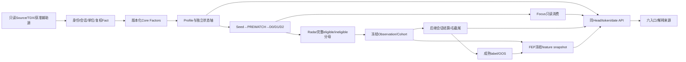
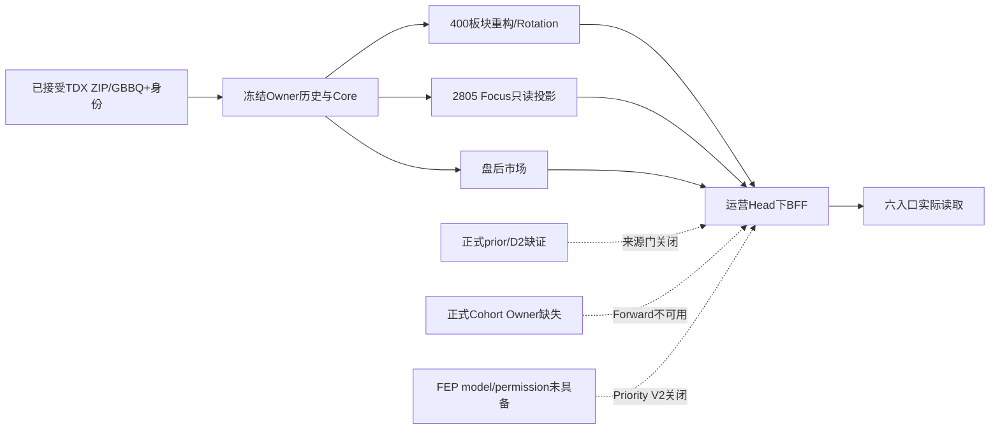

# V4 全系统代码审计 R1 · 2026-10-11

审计结论为 **AUDIT_INCOMPLETE**。本轮已冻结最新分支、审查39个模块范围、执行独立数值复算、隔离回归和真实六入口浏览器检查，并交付16类逻辑产物。原子需求全集、§87A字段家庭全版本展开和所有生产调用关系尚未语义闭环；不能据候选索引、测试数量或本文存在，将全系统评为审计完成或外部验收通过。

审计目标 `codex/v4-fp14-r2-repair`，冻结 SHA `a2eadda9151b37b4cc463bd5c6a7e540be85741a`；fetch 后远端相同。任务书起草 SHA `0fd1f52f50bfbc0f33d9827e325ded1b9d66f544`仅作历史。生产 PID22956 登记加载 `be2a3d6d80c59fa318c3eeffcc6d41abf77fd4dd`，启动时间2026-10-10T11:38:07.282501Z。12个登记模块源码SHA与本轮冻结源码逐一相同；其余加载图不据此推定一致。后续新增桌面引擎、打包与启动链差异单列部署缺证。

本轮范围是审计。没有修改业务代码、TDX、生产数据库、accepted/strict/operational Head、Grant或阶段Gate，没有安装、生产接管或自动交易。所有新缓存、审计脚本、临时PG、测试与截图位于G。子命令TMP/TEMP/TMPDIR指向G；使用既有E:/python解释器不涉及迁移既有应用配置。Git只提交审计轻包，依据用户AGENTS第9条提交和push；任务书内历史执行命令、安装要求和授权文字不构成本轮执行权限。

## 权威、证据层级与分母

主合同为当前本地REV4 FEP R2，版本DA-MSR-V4.2.2-CODEX-REV4-FEP-R2，2026-09-30。精确文件 `docs/evidence/A_SHARE_RESEARCH_SYSTEM_V4_2_2_FINAL_EXECUTABLE_CONTRACT_REV4_FEP_R2_20260930.md`，SHA203ff46075b4039d1e2d45d54fd76ce09509535739cd6aaef4dc394de1015205；与指定Drive可读内容规范化比对一致。Windows采用R2.1（2026-10-10），精确SHAe1069b6a949f6c102f1ef9c78aadef1be67128d1d48dc6a1fe0e7cd0f6f897be。六份指定Drive正文均已读取，原文hash、字数和本地合同/升级历史版本列于权威账本。Overall、CoreAlgo/UI、NextStage的旧HEAD/阶段状态只作背景；DD R2.1、生产发布/first-capture、FP/FEP及Windows各适用版本另列，不继承旧报告的PASS。

Phase0继承回执为FULL_PASS，精确11209字节、SHAfb15e8131405921375c93f277ebdcc1d39ea518399e03f6e55d18bba0003e583已读回，与S0绑定一致；本轮不重授阶段门。Windows R2.1 Drive与本地正文规范化比对相同。

最新G盘指令优先于旧E/F偏好。工程实现、实际可达、真实冻结数据读通、生产能力授权、统计有效性分别判断。独立数值使用E2/E4，隔离PG/故障是E3，当前浏览器是E6；历史S1记录仅是已验记录的读取，不算本轮新E5/E8。无正式issuer签发，不签EXTERNAL_ACCEPTANCE_PASS。

设计索引5550行是权威/升级/设计非空行（含标题、表、代码），**不是5550个原子需求**。新增39行人工模块审查不替代逐需求审查。注册2238条版本出现、613个独立ID/家庭锚点，斜杠家庭未完全展开，因此FIELD_TOTAL/IMPLEMENTED/NOT_IMPLEMENTED的合法全量分母仍为NOT_VERIFIABLE。动态另列现网HTTP所有观察到的响应形状、字段cell、三域全量字段质量计数；某字段存在或质量OBSERVED不等于公式已独立验收。

39模块均PARTIAL：PASS=0/PARTIAL=39/FAIL=0/NOT_VERIFIABLE=0（后者为模块整体而非每个字段）。每行给实际找到的代码及SHA、找不到的定位候选、版本/准入、审查结果与下一条件。未找到的候选文件只是定位尚未证实，不能自动判NOT_IMPLEMENTED。反向表覆盖2951源文件、2805Python/13966符号；282静态潜在可达模块仅是import图，384历史/复制实现另识别，不能用来证明生产调用。函数记录name:start:end:kind，调用压缩为expression@lines；长expression保留前缀与SHA12，可从冻结原文复建。

## 预期与实际数据流、时点和无反馈边界

预期禁止Focus/topK回流Observation选择，禁止当日输出回流当日判定，禁止后验label/修订补成原T0预测。训练使用已成熟且截至cutoff可用的label revision；生产预测只能消费其不可变feature snapshot。数据边CSV记录已读cell source_field/source_digest/source_as_of→API响应SHA；未证明的正式D2/Cohort/FEP边保留空SHA及NOT_VERIFIABLE，完整DAG无反馈审计尚未通过。

运营Head SHA `55d78be5a773c1c7d0475b1a0d755bfa6f4cefb14cc28e273945cc3acf4dc83e`；strict data Head SHA `38e7c9b69aa1b47224aa367bcc58bd3e9963d7c80185c180b5ce02ab48ff3e40`；Stage Head SHA `936a23f219c364eca4799ec6167dfa2916b56914f04e207f819923cf7f25c6f0`。审计开始、接口读后和最终readback相同。

|时点|实际语义与审查限制|
|---|---|
|source_trade_date/T0|行情所属交易日；周日10/11最后可用10/09，不能冒充10/11交易数据|
|source_available/first_available|真实当时可获得证据；本轮重构不证明历史first-available|
|membership_capture|2026-10-09T09:44:01.158745+08:00；historical membership为RECONSTRUCTED_LATEST_MEMBERSHIP|
|accepted_at/publication/revision|已验来源、原子发布与CAS单独绑定；读token是运营Head，不把它当strict/PIT|
|audit_read_at|HTTP记录2026-10-10T23:37:19Z起，北京时间10/11；最终readback另记UTC|
|model selection/prediction cutoff|尚无正式当前model/permission；不能借审计时间回填原T0|
|label_as_of/maturity|按后继真实session与权威label revision选择，不用自然日冒充成熟|

五个真实冻结运营会话为9/28、9/29、9/30、10/08、10/09；股票5222、5223、5224、5224、5224，板块各400。PIT_ELIGIBLE/AS_RECORDED/HISTORICAL_FIRST_AVAILABLE_PROVEN均false，survivorship_bias=true。独立外部接受false，旋转与Forward为持续验证。严格历史入口明确拒绝，不应把重构历史解释为历史策略效果。

## ALGORITHM_AST_AND_ORACLE_AUDIT

本轮独立脚本不import业务算法。以不可变引用的SHA校验输入，使用struct/zip/gzip/Decimal/statistics/bisect重算；源码嵌入命令账本，输入清单与结果保存在权威账本。执行exit0、6.31秒，共92536个逐值比较全部一致。

|组|比较数|独立性边界|
|---|---:|---|
|RPS_CROSS_SECTION|52234|五日全股票rps5/20，以冻结core收益为输入；不是全股票原生收益重放|
|NATIVE_ZIP_RAW|20160|8证券×420真实bar×6字段，32字节原生TDX记录解码，采样ZIP成员CRC由reader校验|
|QFQ_STORED_AFFINE_EVALUATION|13440|8×420×OHLC，以登记仿射系数独立Decimal计算到分；加密GBBQ解码/事件系数全组合未独立重写|
|CORE_WINDOW_FORMULA|272|8证券多个窗口指标，用owner窗口端点；停牌/会话边界另须反例|
|CORE_DERIVED_FORMULA|40|比率与price damage等；不扩展到全字段|
|SECTOR_NATIVE|4800|400板块median/breadth/concentration等；以冻结成员/core/raw为输入|
|SECTOR_SEED_WIDTH|800|400板块已知Seed分母宽度和Wilson下限|
|SECTOR_PERCENTILE|790|行业叶、父派生、概念分池排名；正式prior/D2不在此数值PASS范围|

MA5/20/60包含T；prior_high/low窗口排除T。amount_ratio5/20为当日原生CNY金额/之前5或20实际bar金额均值；不混用辅助源单位。retN=closeT/closeT-N−1，N是实际session；vol是log return总体标准差。TR=max(H−L,abs(H−priorC),abs(L−priorC))，ATR为TR简单窗口均值。slope20=(MA20T−MA20T−5)/ATR20；slope60使用10bar偏移。CLV=(2C−H−L)/(H−L)；price_damage=C<prior_low20−0.5ATR20且ret1<0。RPS=100×(lower+0.5×(ties−1))/(N−1)，单位percentage_points；日收益是fraction，二者不能直接混用。

板块收益median只取合法已知成员，breadth已知ret>0数/合法已知分母；金额集中度top1/top3/总额；Seed k/n及Wilson z=1.96下界。行业父派生不能混入叶级排名池或primary_industry_rank。第一版审计oracle混合父/叶分母出现248个差异；依据已冻结R43-S-002分池修复审计oracle后790项一致，该错误不是产品问题。未重开既有修复。

AST/参数注册存在不等于生产执行；字段表保留参数版本、单位、sourcecell、quality、as_of、实际consumer。无法独立确认的规则填NOT_VERIFIABLE。不能据sampling PASS宣布全部AST阈值、NaN/zero/停牌/一字板或全周期contract一致。

## STATE_EVENT_LIFECYCLE_AUDIT

Seed/PREWATCH与优先级独立：资格FALSE/UNKNOWN不因排序补成TRUE。D0跟踪、D1结构、D2板块高级确认分别需要已验源与先前legal state；Confirmation不能单凭相同字段名接其它producer。Focus读投影绑定T0、Head、来源和实施版本，失效日拒绝同日瞬时reenter，后继合法会话可建立child episode。当前Focus2805项、2804未结束；它不等于全Observation分母，也不等于所有对象已获验证准入。

FA-001确认隔离边界：冻结home函数按INVALIDATED→EXITED→WEAKENED→UPGRADED→REENTERED→NEW排序，随后dict comprehension按实体保留最后一项。合成同实体INVALIDATED+NEW应保留INVALIDATED、risk count1，实际NEW、risk count0。当前已绑定FOCUS快照未发现此同实体多类型组合，**尚未证明线上事故**。不得先改业务代码；建议按冻结reducer选择第一优先事件并补组合反例。FIRST_EXIT与ANY_EVENT的完整Formal Cohort语义仍待旧日独立验证。

## RUNTIME_UI_API_COVERAGE

执行49次read-only HTTP请求：精确path、query、code、响应字节SHA、大小、时长全记录。46次基础检查和3次收尾；两个审计者误猜路径 `/api/v4/operations/daily/status`、`/api/v4/runtime`的409不判产品缺陷。正式daily-update/status真实200 UP_TO_DATE。stale token409、负limit/非法sort/重复trade_date/未来10/12均400。

|入口|实际API/DOM|限制|
|---|---|---|
|今日总览|5224/400、市场四轴、实际变化和风险section|Radar/正式Forward来源未接入；6.31MB响应；FA-001|
|板块研究|400板块、类型/主行业/覆盖等真实表；成员样本32、timeline5、overlap40|当前成员重建、非PIT；正式D2未推定通过|
|个股研究|真实字段/解释、D420/W91/M22图数据；300114搜索识别302132|20/60长窗口与zero/NaN全域未逐条独立验证|
|关注跟踪|2805对象、质量与未结束暴露、真实只读对象|不是ValidationCohort；pin/cutover写操作不执行|
|市场与事件|上涨2989/下跌2107/平113/未知15，amount已知5210、19003.65亿元；涨停72/跌停11/停牌14|盘后daily-only；不是盘中扫描，无交易/概率声明|
|数据与诊断|source/health/contracts/jobs/Shadow/Legacy/FEP域状态明确|closed capability不由测试PASS升级|

六入口均取得1366×768和1920×1080 DOM及截图，共12幅；视口实际内容截图1351×760及1905×1072（scrollbar/窗口内容边界），账本区分请求尺寸与截图尺寸。已查看合成联系表及重点原图：首屏标题/表/风险说明可见，宽表局部横滚，未据首屏声明全长布局无瑕疵。浏览器来自IAB，不是实体双显示器安装验收。

真实SourceDrawer能显示来源字段、SHA、as-of、ZIP/history引用；旧代码300114的搜索与单对象API返回与302132同实体。只读代理限定GET/loopback，故意让市场宽度接口503：局部出现“读取失败，请重试”，指数/涨跌停/事件保留；解除故障并点击重试后宽度恢复。这是实际HTTP/DOM操作，不是monkeypatch DOM。已额外验证股票第2页（offset30）5224总数，以及日期改9/28后重置第1页、5222总数和刷新保持9/28。已额外验证股票第2页（offset30）5224总数，以及日期改9/28后重置第1页、5222总数和刷新保持9/28。已额外验证股票第2页（offset30）5224总数，以及日期改9/28后重置第1页、5222总数和刷新保持9/28。未测试全部导出、keyboard/accessibility、所有empty/page/filter组合；不能把UI覆盖泛化为全功能PASS。

历史比较额外发现：as_of9/28、left300114/right688349显示COMPARE_OBJECT_NOT_PRESENT，改302132实际成功（FA-013）。股票比较表固定请求sector_rs5/20导致“字段未接入”，而同一API行rps5=61.82516810758886、rps20=56.689124157844084均OBSERVED（FA-014）；这是已复现页面映射问题，不能归为行情来源不足。

## DAILY_SOURCE_ADMISSION_AND_RELEASE_AUDIT

当前DD01–DD07使用immutable acquired/cache→source readiness→事实/数值QA→候选→独占锁/CAS→HTTP readback→COMMITTED，失败回滚精确前驱，pending crash恢复前驱；具体隔离测试与真实调度状态分开。固定source schema/SDK hash；BaoStock adjustFacto仅在精确schema允许下归一，空数据不得捏造provider_date；TDX只读原件不变。

真实jobs autoenabled revision5，触发18:35，重试19:05/19:35/20:05/20:35/21:05/22:05，next10/12。最后10/09 PUBLISHED_FULL attempt2，source_ready=true、TDX5559/Bao5224。记录的结束约19:57；现在周日UP_TO_DATE missing=[]。本轮不调用update/run，不改调度；生产进程不中断。

原子替换、idempotency、并发源协调、CAS冲突与进程race在G盘隔离环境执行。测试会使用合成未来日期，明确是unit fixture，不是未来市场事实。未对生产断电/杀进程，不声称真实10/12 E5后继链。Source/State/Identity可信issuer与writer grant、首获窗口、source_available≤accepted≤now≤deadline需要真实现场回执。不能把修订重构补作原first-observed。

## FEP_FORWARD_COHORT_AUDIT

E1按feature/label revision与cutoff、成熟状态和entity/episode/time partition建立dataset；E2条件基线，E3时序split/标签purge，E4树仅challenger，E5绑定model_set/snapshot/target/horizon和独立Grant。工程Ledger布尔值、调用者自带JSON、shadow排序结果均不能发生产能力。E2/E3注册写出只允许E/F的冲突FA-005在本轮G盘测试出现，等待修复；树训练环境缺sklearn未安装，不伪造训练回执。

真实Forward读域200 SOURCE_INCOMPLETE/NO_AUTHORIZED_COHORT_OWNER。FEP200 SOURCE_INCOMPLETE/MODEL_OR_PERMISSION_NOT_READY，全部capability NOT_GRANTED；不明成熟计数为null，不写0。当前Focus只读tracking/outcome不替代正式eligible/ineligible Cohort分母。无真实mature OOS则Priority V2关闭；现网基础六入口继续读通，FEP缺口不阻塞本地主读流。Forward T+1/3/5/10/20使用交易日序号，缺收盘/退市右截尾不补0%收益，但所有正式到期只结一次与右截尾反例尚未全量重跑。

## WINDOWS_FULL_PACKAGE_S0_S2_AUDIT

读取既有回执并独立核对交付字节：S0_PASS_ENGINEERING_CONTRACT_AND_ISOLATED_BOUNDARIES；S1_PASS_FROZEN_RUNTIME_TRAY_FUNCTIONS_AND_FULL_NUMERIC_REPLAY，既有无Python PATH/actual frozen EXE证据；S2_ISOLATED_INSTALLER_ENGINEERING_PASS_REAL_MACHINE_ACCEPTANCE_PENDING（13检查、2645文件）。工程安装器通过不能称用户机器已装/已登录重启/托盘可用。

包版本V4_PACKAGE_1.0.0_27b2ec1ed284，与本轮冻结HEAD分开。DaAV4.exe 20941480字节 SHA74ae310c2541ac1c281b2f253d81839ee68c7be438e603ad9b23a9a51c820a7c；安装器SHA40256a5cf8b1ec8f4aa6f9e726332a45cfd20133547a0bb52971841fa887348f。完整绝对路径、receipt哈希记录命令账本。未运行安装器、未真实接管生产、未测试物理双显示器/重启/登录/卸载。隔离单元对dispatcher/jobs/process races的通过只支撑所测工程范围；源码新desktop模块不能据既有S1自动取得新准入。

## 故障与反事实18项

|#|预期/实际验证|结论与缺证|
|---:|---|---|
|1|周末读lastgood10/09，六入口核心数据可见|真实本轮10/11；任务书10/10不倒填现场时间|
|2|source字节/CRC/Bao/时区/成员/复权各拒绝|SHA与采样CRC、隔离source负例已测；全包损坏/每类现场注入未执行，PARTIAL|
|3|更码等按日身份，禁未来Universe|300114/302132真实单对象与搜索；比较别名FAIL；ST/退市全史PARTIAL|
|4|五日账户/来源独立replay|五日API/RPS冻结读通；完整五日全DAG重发布未执行，PARTIAL|
|5|缺prior RPS须UNKNOWN|质量计数与源规则可定位；所有前日缺失组合独立真实oracle未完，PARTIAL|
|6|小板块/LOO不能伪共振|全n=1/2/multi-membership独立旧日反例NOT_VERIFIABLE|
|7|多板块同股唯一事件/episode|Focus去重unit范围；全正式分母多场景回放PARTIAL|
|8|失效日不瞬时重入，次日合法重入|Focus隔离负例范围通过；真实全对象跨日PARTIAL|
|9|Confirmation+Invalidated优先、FIRST_EXIT分开|home反例FA-001 FAIL；完整Formal ANY/FIRST退出回放未完|
|10|revision/CAS/跨日期/token不混版本|实际stale409/重复日期400、隔离CAS/race；生产切换未执行|
|11|不足20/停牌/ATR0/NaN/周月incomplete区分|core窗口+period/source负例/质量计数；全边界集合PARTIAL|
|12|到期只结一次，缺价/退市不作零收益|工程Forward源存在；正式新Cohort缺失，NOT_VERIFIABLE当前正式结果|
|13|旧模型后验不补预测|真实FEP closed；E5 isolated negative/append-only，不代表真实预测|
|14|页面局部失败重试/历史日期/搜索|真实503局部恢复、日期比较、别名；FA-013/014；全部分页/导出PARTIAL|
|15|CAS与readback间退出恢复lastgood|独立进程race测试；生产断电未执行，PARTIAL|
|16|frozen EXE dispatcher无Python启动|既有S1 receipt+本轮字节核对；非本轮实体安装现场|
|17|旧SHA修复实装不可推定|12登记模块同字节，但whole process a2eadda加载NOT_VERIFIABLE|
|18|FEP无label/model维持V2关闭，基础读不受阻|真实六入口与NOT_GRANTED同时观察，所测读范围PASS|

## 问题、验收与下一阶段

未在已执行范围发现P0；全§87A/全部权限危险SQL/全DAG/真实断电等缺证使它不能表述为“零缺陷”。**新确认问题**P1两项（FA-001优先级、FA-005G盘合同），P2两项（FA-013比较别名、FA-014页面字段）。另有既有正式门P1两项FA-002/003，观察到的性能风险P2 FA-004和QA再现/triage P2 FA-006；WAIT_REAL_SESSION FA-008、WAIT_OOS FA-011、WAIT_USER_AUTH FA-007，独立Amount A FA-012，旧日覆盖FA-010。FA-009是审计完成缺口，不与业务缺陷混计。

回归非全绿，不等于所有失败均是线上事故。主run08为1301 passed/225 skipped/41 failed/35 errors； targeted为103 passed/3 failed；补齐部分精确输入并修正E5隔离DB后rerun为86 passed/2 failed/7 errors。修正后的E5工程Ledger负例通过，M14 contract/calendar两个原失败通过；M14旧probe report在主工作区也缺失，仍未通过。V4-11 persistence会自动新建未登记PG端口，被全局隔离守卫拒绝，未绕过安全守卫；24个named-symbol scan hardgate命中属于audit/QA脚本分类待triage，不能称发现24个生产股票硬编码事故。旧stage13夹具、B0producer兼容、sklearn依赖等均有具体JUnit节点。详细命令/exit/输入性质与未执行项见命令账本。

本轮阶段合同：FULL_SYSTEM_AUDIT_R1，验收AUDIT_INCOMPLETE，下一阶段为B类旧日可审计补证和逐需求/字段语义闭环，A类修复只给建议，C/D/E保持各自门。不得因Gitpush、单元通过或报告存在进入下一生产阶段；无EXTERNAL_ACCEPTANCE_PASS。

## 16类逻辑交付定位

report、algorithm/state/UI/daily/FEP/Windows七份正文合并在本文件；authority/runtime JSON、design→code CSV、code→design CSV、field CSV、lineage CSV、module CSV、independent issues JSON、next batches MD、commands/readback MD组成10文件。候选CSV空公式/权限不是PASS，动态SHAPE_ONLY空base_sha继承账本冻结BASE且不声明字段算法已实现；null source digest保持未知。本轮轻包限额和逐文件回读SHA见命令账本末尾。大行情原件/DB/ZIP保留本机G路径和hash，不入库重复上传。
